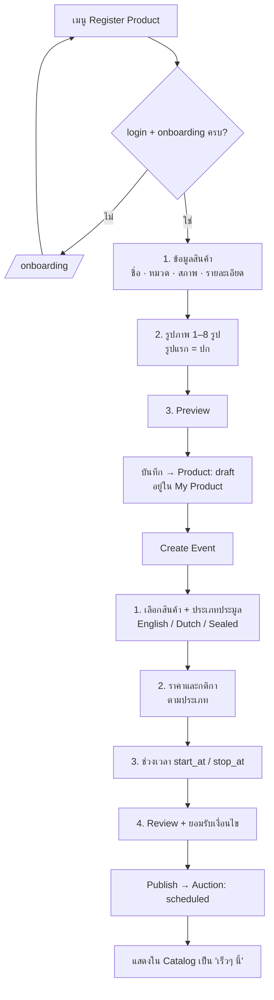
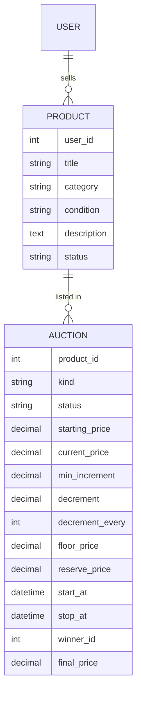

# M02 · Product Onboarding (ผู้ขายลงสินค้า → เปิด Event)

> ภาพรวมทั้งหมด: [README](./README.md) · ก่อนหน้า: [M01 User Onboarding](./M01-user-onboarding.md) · ถัดไป: [M03 Product Catalog](./M03-product-catalog.md)
>
> สถานะ: **ร่างแบบ (design draft)** · ต้องมี: Auth + M01

แยกเป็น 2 ขั้นที่สอดคล้องกับเมนูเดิม: **Register Product** (ข้อมูลสินค้า) และ **Create Event** (ตั้งค่าการประมูล) เพื่อให้สินค้าชิ้นเดียวกันนำมาเปิดประมูลใหม่ได้ถ้าครั้งแรกขายไม่ออก

## M02.1 Flow

## M02.2 ข้อมูลสินค้า (Product)

| Field | กติกา |
|---|---|
| `title` | บังคับ, 5–80 ตัวอักษร |
| `category` | เลือกจากรายการ (กล้อง, นาฬิกา, เครื่องดนตรี, กีฬา, ของสะสม, ไอที, เฟอร์นิเจอร์, ศิลปะ, อื่นๆ) |
| `condition` | ใหม่ / เหมือนใหม่ / มือสองสภาพดี / มีตำหนิ |
| `description` | บังคับ, ≥ 20 ตัวอักษร |
| `images` | Active Storage, 1–8 รูป, jpg/png/webp, ≤ 5 MB ต่อรูป |

## M02.3 ตั้งค่า Event ตามประเภทประมูล

| ประเภท | Field ที่ต้องกรอก | ความหมาย |
|---|---|---|
| **English** (ราคาขึ้น) | `starting_price`, `min_increment`, `reserve_price` (ไม่บังคับ) | ราคาขึ้นทีละไม่น้อยกว่า increment ใครเสนอสูงสุดตอนปิดชนะ |
| **Dutch** (ราคาลง) | `starting_price`, `decrement`, `decrement_every` (นาที), `floor_price` | ราคาลดลงตามเวลา คนแรกที่กด "ซื้อเลย" ชนะ |
| **Sealed** (ซองปิด) | `starting_price` (ราคาขั้นต่ำ), `reserve_price` (ไม่บังคับ) | ทุกคนยื่นราคาโดยไม่เห็นของคนอื่น ราคาสูงสุดตอนปิดชนะ |

กติกาเวลา: `start_at ≥ now + 15 นาที`, ระยะเวลา 1 ชม. – 14 วัน (Dutch: `floor_price` ต้องมาถึงได้ก่อน `stop_at`)

## M02.4 แก้ไข / ยกเลิก

- `scheduled` (ยังไม่เริ่ม): แก้ไขได้ทุกอย่าง และยกเลิกได้
- `live` และยังไม่มี bid: ยกเลิกได้ แต่แก้ราคาไม่ได้
- `live` และมี bid แล้ว: ผู้ขายยกเลิกเองไม่ได้ ต้องให้ admin ทำ
- ลบสินค้าที่อยู่ใน Event `live` ไม่ได้
- Event ที่จบแบบ `no_sale` นำสินค้าไปเปิด Event ใหม่ได้

## M02.5 Data model

- `Product.status`: `draft` → `listed` → `sold` / `unsold`
- `Auction.status` และการเปลี่ยนสถานะทั้งหมดอยู่ใน [M04](./M04-bidding.md#m045-ปิดประมูล-ทุกประเภท) (M02 สร้างได้แค่ `draft` → `scheduled` และยกเลิกเป็น `cancelled`)
- index: `auctions(status, stop_at)`

## M02.6 Routes

| Method | Path | ใช้ทำอะไร |
|---|---|---|
| GET/POST | `/products/new`, `/products` | Register Product |
| GET | `/my/products` | My Product |
| GET/POST | `/events/new`, `/events` | Create Event (สร้าง `Auction`) |
| GET | `/my/events` | My Event |
| PATCH | `/events/:id`, `/events/:id/cancel` | แก้ไข/ยกเลิก |

## M02.7 คำถามที่ยังต้องตัดสินใจ

1. ต้องมี admin ตรวจสินค้าก่อน publish ไหม (เพิ่มสถานะ `pending_review`)

## M02.8 Definition of Done

- ผู้ใช้ที่ onboarding ครบลงสินค้าพร้อมรูปได้ และเห็นใน My Product
- สร้าง Event ได้ครบทั้ง 3 ประเภท ตรวจ field ตามตาราง M02.3 ฝั่ง server
- Event ที่ publish แล้วมีสถานะ `scheduled` และตั้ง `StartAuctionJob` ไว้ (ตัว job อยู่ใน M04)
- มี model test และ controller test สำหรับกติกาใน M02.2–M02.4
