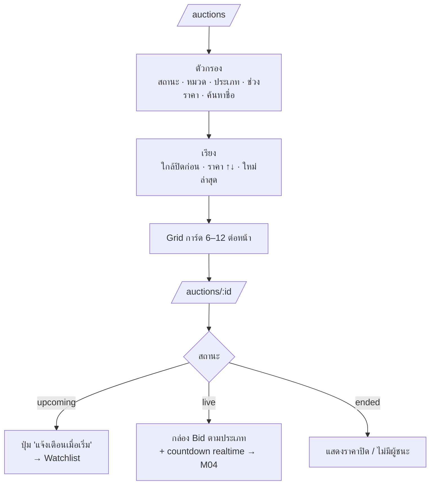
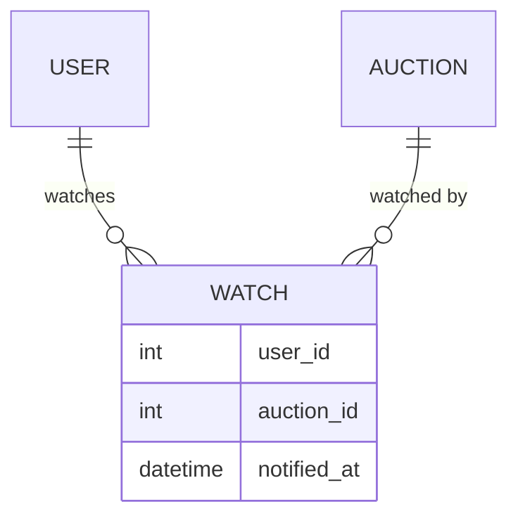

# M03 · Product Catalog (เลือกดูสินค้า)

> ภาพรวมทั้งหมด: [README](./README.md) · ก่อนหน้า: [M02 Product Onboarding](./M02-product-onboarding.md) · ถัดไป: [M04 Bidding](./M04-bidding.md)
>
> สถานะ: **ร่างแบบ (design draft)** · ต้องมี: M02 (`Auction` model)

ต่อยอดจากหน้า `/auctions` เดิมที่มีตัวกรองสถานะ การเรียง และแบ่งหน้าอยู่แล้ว (`AuctionsController#index`) โดยเปลี่ยนจาก mock data ไปดึงจาก `Auction` model

## M03.1 Flow

## M03.2 สิ่งที่แสดงตามสถานะ

| ส่วนของหน้า | upcoming | live | ended |
|---|---|---|---|
| ราคาบนการ์ด | ราคาเริ่มต้น | ราคาล่าสุด (English), ราคาปัจจุบัน (Dutch), "ซองปิด" (Sealed) | ราคาปิด |
| Countdown | เวลาที่จะเริ่ม | เวลาที่จะปิด | เวลาที่ปิดไปแล้ว |
| ประวัติการ bid | ไม่แสดง | English: แสดง (ปิดชื่อบางส่วน เช่น `p***a`), Sealed: แสดงแค่จำนวน bid | แสดงทั้งหมด (Sealed เปิดหลังปิดประมูล) |
| ปุ่มหลัก | แจ้งเตือน | ประมูลเลย / ซื้อเลย | ดูรายละเอียด |

กล่อง bid และการอัปเดตราคาแบบ realtime เป็นงานของ [M04](./M04-bidding.md) ใน M03 หน้ารายละเอียดแสดงข้อมูลแบบอ่านอย่างเดียวพร้อมช่องว่างไว้สำหรับกล่อง bid

## M03.3 กติกาการมองเห็น

- `draft` / `cancelled`: ไม่แสดงใน catalog (เจ้าของยังเห็นใน My Event)
- ใน `ended` แสดงย้อนหลังแค่ 30 วัน
- การ์ดที่เป็นสินค้าของตัวเองติดป้าย "สินค้าของคุณ" และไม่มีปุ่ม bid
- countdown อ้างอิงเวลาจาก server

## M03.4 Watchlist

- กด "แจ้งเตือนเมื่อเริ่ม" ได้เฉพาะรายการ `upcoming` และต้อง login
- เมื่อ Event เริ่ม (`StartAuctionJob` ใน M04) ส่งแจ้งเตือนให้ทุกคนที่ watch แล้วตั้ง `notified_at`

- unique index: `watches(user_id, auction_id)`

## M03.5 Routes

| Method | Path | ใช้ทำอะไร |
|---|---|---|
| GET | `/auctions` | Catalog (มีอยู่แล้ว ต้องเปลี่ยนไปดึงจาก DB) |
| GET | `/auctions/:id` | หน้ารายละเอียด |
| POST/DELETE | `/auctions/:id/watch` | เพิ่ม/ลบ Watchlist |

## M03.6 Definition of Done

- `/auctions` ดึงข้อมูลจาก `Auction` จริง ตัวกรองและการเรียงเดิมยังทำงาน และเพิ่มตัวกรองหมวด ประเภท ช่วงราคา และค้นหาชื่อ
- หน้า `/auctions/:id` แสดงผลถูกต้องทั้ง 3 สถานะตามตาราง M03.2
- Watchlist ทำงาน
- มี controller test สำหรับตัวกรอง กติกาการมองเห็น และ Watchlist
