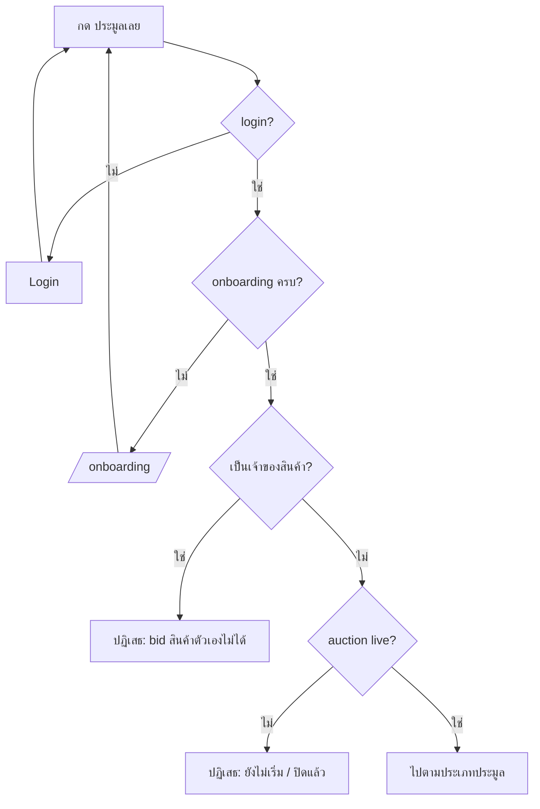
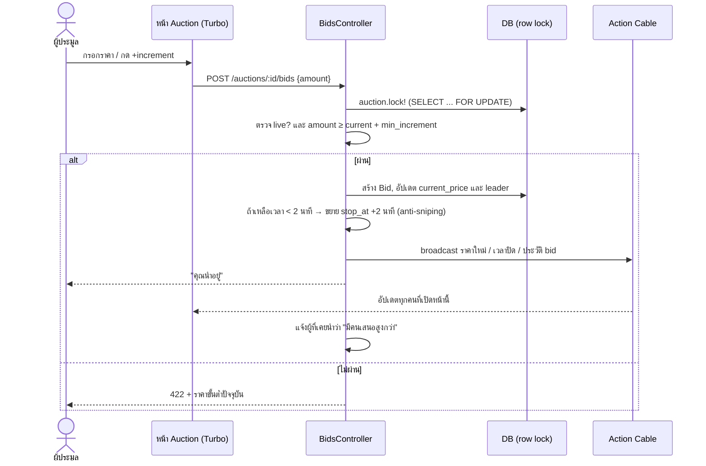
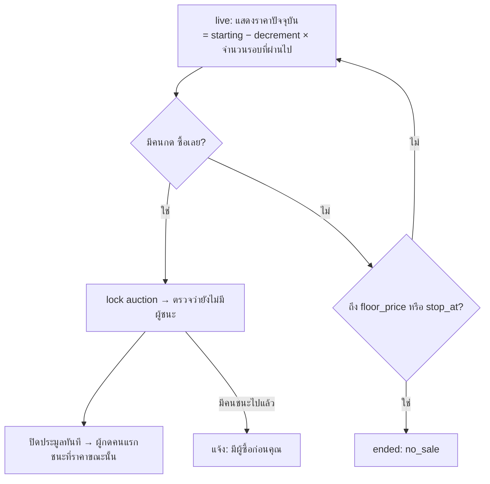
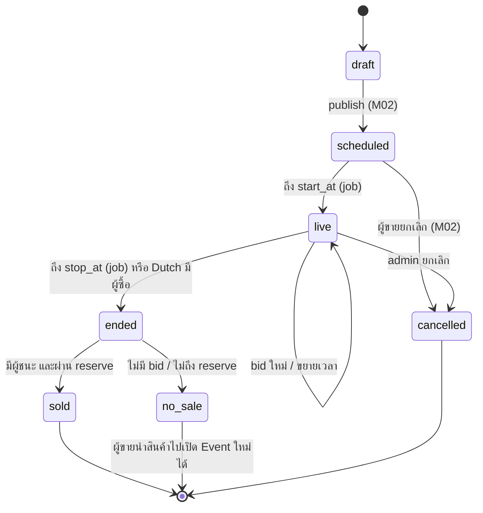
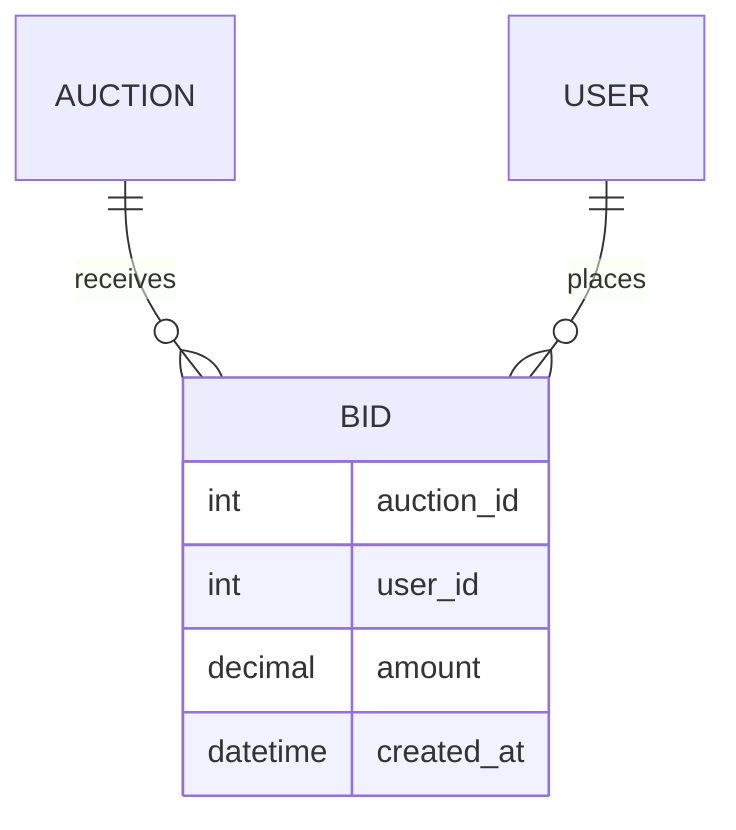

# M04 · Bidding Flow

> ภาพรวมทั้งหมด: [README](./README.md) · ก่อนหน้า: [M03 Product Catalog](./M03-product-catalog.md)
>
> สถานะ: **ร่างแบบ (design draft)** · ต้องมี: M02 (`Auction`) + M03 (หน้ารายละเอียด)

## M04.1 Gate ก่อน bid

## M04.2 English auction

- ปุ่มลัด: `+1×`, `+2×`, `+5×` increment
- ก่อนส่งมี modal ยืนยัน: "ยืนยันเสนอราคา ฿X? ยกเลิกไม่ได้"
- ผู้ที่นำอยู่แล้วเสนอซ้ำได้ (เพิ่มราคาตัวเอง) ไม่ต้อง block
- ขยายเวลาจาก anti-sniping รวมกันได้ไม่เกิน +30 นาที
- (ภายหลัง) Proxy bid: ตั้งราคาสูงสุด แล้วระบบเสนอให้อัตโนมัติ

## M04.3 Dutch auction

- server คำนวณราคาจากเวลาทุกครั้ง ไม่เชื่อราคาที่ client ส่งมา แต่ client ส่ง `expected_price` มาด้วย ถ้าไม่ตรงกันให้ถามยืนยันใหม่

## M04.4 Sealed auction

- ยื่นได้ 1 ซองต่อคน **เพิ่มราคา** ได้จนถึงเวลาปิด แต่ลดหรือถอนไม่ได้
- ไม่แสดงราคาของคนอื่น แสดงแค่ "คุณยื่นไว้ ฿X" และจำนวนผู้ยื่นทั้งหมด
- ตอนปิด ราคาสูงสุดชนะ ถ้าเท่ากันคนที่ยื่นก่อนชนะ
- ไม่มี anti-sniping

## M04.5 ปิดประมูล (ทุกประเภท)

- ใช้ Solid Queue (มีอยู่ในแอปแล้ว) ตั้ง `StartAuctionJob` / `CloseAuctionJob` ไว้ที่ `start_at` / `stop_at` ถ้าเวลาถูกขยายให้ job ตรวจ `stop_at` ซ้ำแล้ว reschedule
- `StartAuctionJob` ส่งแจ้งเตือน Watchlist ของ [M03](./M03-product-catalog.md#m034-watchlist) ด้วย
- ตอนปิด: lock → หาผู้ชนะ → ตั้ง `winner_id`, `final_price` และสถานะ → แจ้งผู้ชนะ ผู้ขาย และผู้แพ้
- การชำระเงินและจัดส่ง: **นอกขอบเขตรอบนี้** (หน้าสรุปแสดงแค่ "ติดต่อผู้ขาย")

## M04.6 Data model

- index: `bids(auction_id, amount DESC)`, unique `bids(auction_id, user_id)` เฉพาะ Sealed (ทำใน model validation เพราะ English ให้ bid ซ้ำได้)

## M04.7 Routes

| Method | Path | ใช้ทำอะไร |
|---|---|---|
| POST | `/auctions/:id/bids` | bid (English/Sealed) |
| POST | `/auctions/:id/buy_now` | ซื้อเลย (Dutch) |
| GET | `/my/bids` | รายการที่ฉันเคย bid |

## M04.8 Edge cases ที่ต้องรองรับ

- bid 2 คนพร้อมกันที่ราคาเดียวกัน: lock แถวแล้ว คนที่มาถึงทีหลังได้ 422 พร้อมราคาขั้นต่ำใหม่
- Dutch กดซื้อพร้อมกัน: คนแรกที่ได้ lock ชนะ คนอื่นได้ "มีผู้ซื้อก่อนคุณ"
- bid เข้ามาหลัง `stop_at` แต่ก่อน job ปิดทำงาน: ตรวจ `stop_at` ใน transaction แล้วปฏิเสธ
- ผู้ใช้ที่ถูกระงับบัญชี: bid ที่เคยวางไว้ยังอยู่ แต่ bid ใหม่ไม่ได้

## M04.9 คำถามที่ยังต้องตัดสินใจ

1. ต้องวางมัดจำ หรือจำกัดวงเงิน bid ตาม `income_range` จาก M01 ไหม
2. รองรับ Proxy bid ใน English ตั้งแต่รอบแรกเลยไหม

## M04.10 Definition of Done

แนะนำให้ทำ English ให้เสร็จก่อน แล้วค่อยต่อ Dutch และ Sealed

- bid แบบ English ได้ มี anti-sniping และราคาอัปเดตแบบ realtime ผ่าน Turbo Streams
- Dutch และ Sealed ทำงานตามกติกา M04.3–M04.4
- job เริ่ม/ปิดประมูลทำงาน และตั้งผู้ชนะถูกต้อง รวมกรณีไม่ถึง reserve
- หน้า My Bids
- มี test สำหรับการ bid พร้อมกัน, anti-sniping, การหาผู้ชนะของทั้ง 3 ประเภท
