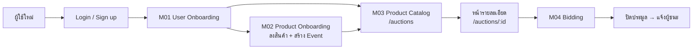
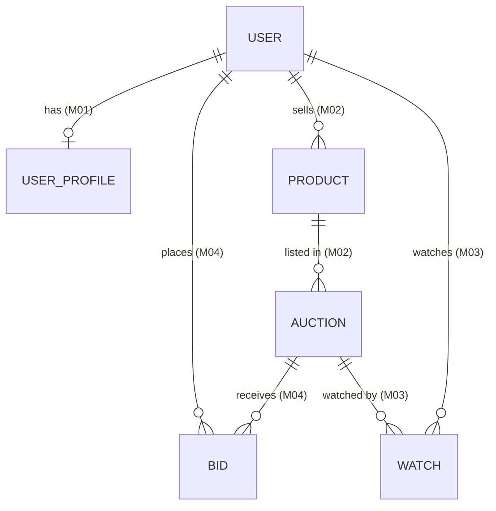
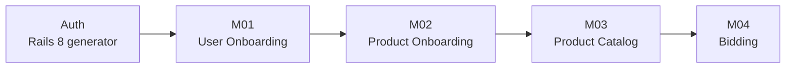

# Noom Auction: แผนงาน M01–M04

> สถานะ: **ร่างแบบ (design draft)** ยังไม่มีโค้ด

| Milestone | Flow | ไฟล์ |
|---|---|---|
| **M01** | User Onboarding: บัตร ปชช. · อาชีพ · รายได้ · ประสบการณ์ | [M01-user-onboarding.md](./M01-user-onboarding.md) |
| **M02** | Product Onboarding: ผู้ขายลงสินค้า + สร้าง Event | [M02-product-onboarding.md](./M02-product-onboarding.md) |
| **M03** | Product Catalog: เลือกดูสินค้า + หน้ารายละเอียด | [M03-product-catalog.md](./M03-product-catalog.md) |
| **M04** | Bidding: English / Dutch / Sealed + ปิดประมูล | [M04-bidding.md](./M04-bidding.md) |

## ภาพรวม

## ใครทำอะไร

| Actor | สิทธิ์ |
|---|---|
| Guest | ดู catalog และหน้ารายละเอียดได้ แต่ bid หรือลงสินค้าไม่ได้ |
| Member (onboarding ครบ) | bid ได้ ลงสินค้าได้ (เป็นทั้งผู้ซื้อและผู้ขาย) |
| Seller (= Member ที่เป็นเจ้าของสินค้า) | จัดการสินค้า/Event ของตัวเอง แต่ bid สินค้าตัวเองไม่ได้ |
| Admin (ภายหลัง) | ตรวจสินค้า ยกเลิก Event |

## กติกาที่ใช้ร่วมกันทุก Milestone

- **Gate:** ทุก action ที่เขียนข้อมูล (ลงสินค้า, สร้าง Event, bid) ต้อง `logged_in?` **และ** `onboarding_completed?` ไม่อย่างนั้น redirect ไป `/onboarding` แล้วพากลับมาหน้าเดิม (เก็บ `return_to` ใน session)
- **ต้องมี Auth ก่อน:** M02–M04 ต้องมี DB model และระบบ login จริง ซึ่งตอนนี้ยังไม่มีในแอป (M01 ร่างไว้แบบเก็บใน session) แนะนำให้เริ่มจาก `bin/rails generate authentication` ของ Rails 8 แล้วย้ายข้อมูล M01 ไปเก็บใน `User` / `UserProfile`
- **เงิน:** เก็บเป็นจำนวนเต็มหน่วยบาท (`integer`) หรือ `decimal(12,2)`: เลือกแบบเดียวแล้วใช้ทั้งระบบ
- **ข้อมูลส่วนบุคคล:** `national_id` ใช้ Active Record Encryption และกรองออกจาก log (PDPA)
- **เวลา:** countdown ทุกหน้าอ้างอิงเวลาจาก server (`server_now` ส่งมากับหน้า) ไม่ใช้นาฬิกาเครื่องผู้ใช้

## Data model รวม (ร่าง)

รายละเอียด field ของแต่ละตารางอยู่ในไฟล์ของ Milestone ที่สร้างตารางนั้น

## ลำดับงาน

- M03 ต้องมีข้อมูล `Auction` จาก M02 ก่อน (ระหว่างนี้หน้า `/auctions` ใช้ mock data ไปก่อนได้)
- M04 ต่อจากหน้ารายละเอียดของ M03

## คำถามที่ยังต้องตัดสินใจ (ข้ามหลาย Milestone)

1. ค่าธรรมเนียมผู้ขาย และวิธีชำระเงิน (รอบนี้ยังไม่ทำ)
2. ช่องทางแจ้งเตือน (ใช้ใน M03 Watchlist และ M04 outbid / ผู้ชนะ): ในเว็บอย่างเดียว หรือมีอีเมลด้วย

คำถามเฉพาะของแต่ละ flow อยู่ท้ายไฟล์ของ Milestone นั้น
